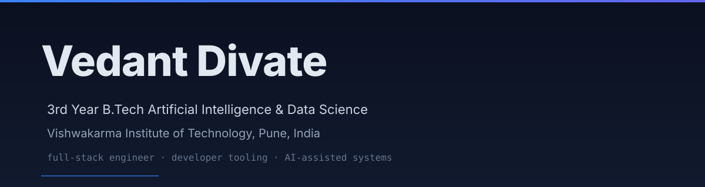

  

  

  

  
  
  
  
  

---

## ⚡ Executive Summary

I am a **3rd Year Artificial Intelligence & Data Science** student at **Vishwakarma Institute of Technology (VIT Pune)** with a passion for building **developer tooling**, **interactive code visualizers**, and **data-driven products with verifiable provenance**. 

My engineering focus spans low-level code mechanics (Babel AST instrumentation and Web Workers sandboxing), symbolic AI reasoning (SWI-Prolog), human-in-the-loop validation architectures, and trustless escrow protocols.

- 🔭 **Currently Building:** AST-driven developer tools and verifiable AI workflows
- 💡 **Core Expertise:** TypeScript, Python, React, Node.js, Web Workers, AST Transforms & Symbolic AI
- 🎯 **Looking For:** Software Engineering & Product R&D Internships (Summer/Fall 2025–2026) · Remote or On-site

  

## 🔬 Featured Projects & Systems

<table>
  <!-- Row 1 -->
  <tr>
    <td width="50%" valign="top">
      <h3>🔬 LogicLens</h3>
      
<b>Interactive Code Execution Visualizer</b>

      
Parses JavaScript source code via Babel into an Abstract Syntax Tree (AST), instruments statements, and executes them inside an isolated Web Worker to step-through memory, variables, and the call stack with zero main-thread jank.

      

        
        
        
        
      

      

        
        
      

    </td>
    <td width="50%" valign="top">
      <h3>🔗 LinkPe</h3>
      
<b>Decentralized Freelance Escrow Protocol</b>

      
Trustless milestone escrow platform supporting USDC payouts on EVM chains, client-freelancer dispute settlement state machines, and end-to-end encrypted IPFS deliverable handoffs.

      

        
        
        
        
      

      

        
        
      

    </td>
  </tr>
  <!-- Row 2 -->
  <tr>
    <td width="50%" valign="top">
      <h3>💊 SameDrug</h3>
      
<b>Drug Price Transparency & Provenance Pipeline</b>

      
Pharmaceutical pricing transparency engine comparing NPPA government price ceilings against affordable Jan Aushadhi generic alternatives. Normalizes per-unit prices with strict data provenance across 2,439 products and 302 verified comparisons.

      

        
        
        
        
      

      

        
        
      

    </td>
    <td width="50%" valign="top">
      <h3>🌊 StreamTrust</h3>
      
<b>Human-in-the-Loop Ecological Telemetry</b>

      
Mobile-optimized field application guiding environmental volunteers through stream diagnostics. AI suggests photo-based telemetry while human volunteers verify inputs, persisting observations into clinical/ecological FHIR records with audit trails.

      

        
        
        
        
      

      

        
        
      

    </td>
  </tr>
  <!-- Row 3 -->
  <tr>
    <td width="50%" valign="top">
      <h3>🧩 hangman_ai_solver</h3>
      
<b>Symbolic AI Game Engine & Agent</b>

      
A declarative symbolic reasoning engine written in SWI-Prolog paired with a Node.js backend. Serves as both an infallible game referee and an intelligent agent performing game-state tree search.

      

        
        
        
      

      

        
      

    </td>
    <td width="50%" valign="top">
      <h3>📚 StudyGraph & Microservices</h3>
      
<b>Interactive Knowledge Graphs & Distributed Services</b>

      
Graph-based relational topic visualizers and containerized microservices architecture with backend message brokers and observability tooling.

      

        
        
        
      

      

        
        
      

    </td>
  </tr>
</table>

  

## 🛠️ Technical Arsenal

  

<table>
  <tr>
    <td width="24%"><b>💻 Languages</b></td>
    <td width="76%">TypeScript · JavaScript (ESNext) · Python 3 · SWI-Prolog · Solidity · SQL · C/C++</td>
  </tr>
  <tr>
    <td><b>⚛️ Frontend & UI</b></td>
    <td>React.js · Next.js · HTML5 Canvas · Tailwind CSS · Vite · Web Components · Responsive UI/UX</td>
  </tr>
  <tr>
    <td><b>🚀 Backend & APIs</b></td>
    <td>Node.js · Express.js · FastAPI · RESTful Architecture · GraphQL · WebSockets</td>
  </tr>
  <tr>
    <td><b>⚙️ Systems & Core</b></td>
    <td>Babel AST Instrumentation · Web Workers Execution Sandbox · IPFS · Smart Contract Escrow</td>
  </tr>
  <tr>
    <td><b>🧠 AI & Data Stack</b></td>
    <td>Pandas · NumPy · Computer Vision (YOLO) · Symbolic Logic Engines · FHIR Data Schemas</td>
  </tr>
  <tr>
    <td><b>🧰 DevOps & Tooling</b></td>
    <td>Git · GitHub Actions CI/CD · Docker · Vercel · Render · VS Code · Linux</td>
  </tr>
</table>

  

## 📊 Activity & Analytics

  
  

  

  

## 🧭 Engineering Values

- **Clarity Over Obscurity:** Software should be observable and inspectable. Whether parsing ASTs to reveal runtime execution or generating clear state diagrams, transparency leads to better engineering.
- **Data Provenance Matters:** In an era of black-box outputs, systems must trace where data originates, who verified it, and how transformations occurred.
- **Fluid, Resilient Interfaces:** Heavy computation belongs in background workers and async queues. The user experience should remain responsive, elegant, and 60 FPS under all conditions.

  

## 🤝 Let's Connect

I am actively looking for **Software Engineering & Product Development Internships** for 2025–2026. Whether you have an exciting project, an internship opportunity, or want to discuss AST tooling and symbolic AI, my inbox is always open!

  
  &nbsp;
  
  &nbsp;
  

  Designed &amp; Engineered by <b>Vedant Divate</b> · VIT Pune · Open Source Contributor 
  ⭐ If you find any of my repositories helpful, feel free to drop a star!

